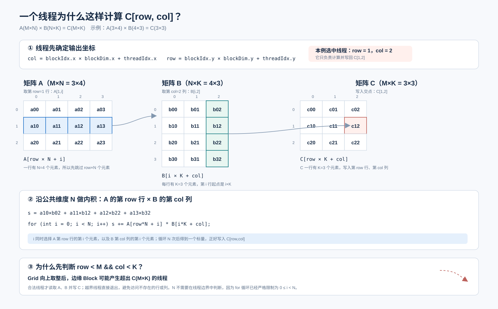

## 题目定义

编写一个 GPU 程序，计算两个 32 位浮点矩阵的乘积。

已知矩阵 `A` 的形状为 `M × N`，矩阵 `B` 的形状为 `N × K`，计算：

```text
C = A × B
```

输出矩阵 `C` 的形状为 `M × K`。所有矩阵均采用行主序存储。

输出元素 `C[row, col]` 的计算公式为：

```text
C[row, col] = Σ A[row, i] × B[i, col]，0 ≤ i < N
```

### 实现要求

- 只使用原生 CUDA 功能，不允许使用外部库
- `solve` 函数签名必须保持不变
- 最终结果必须写入矩阵 `C`

### 示例 1

```text
输入：

A（2 × 2）：
[1.0  2.0]
[3.0  4.0]

B（2 × 2）：
[5.0  6.0]
[7.0  8.0]

输出：

C（2 × 2）：
[19.0  22.0]
[43.0  50.0]
```

第一行第一列的计算过程为：

```text
C[0,0] = 1.0 × 5.0 + 2.0 × 7.0 = 19.0
```

### 示例 2

```text
输入：

A（1 × 3）：
[1.0  2.0  3.0]

B（3 × 1）：
[4.0]
[5.0]
[6.0]

输出：

C（1 × 1）：
[32.0]
```

对应的计算过程为：

```text
C[0,0] = 1.0 × 4.0 + 2.0 × 5.0 + 3.0 × 6.0 = 32.0
```

### 约束

- `1 ≤ M, N, K ≤ 8192`
- 性能测试使用 `M = 8192`、`N = 6144`、`K = 4096`

## 模板代码解析

模板提供了 GPU kernel 的声明和 CPU 端入口函数 `solve`，需要补全 `matrix_multiplication_kernel` 的函数体。

```cpp
#include <cuda_runtime.h>

__global__ void matrix_multiplication_kernel(
    const float* A,
    const float* B,
    float* C,
    int M,
    int N,
    int K
) {}

extern "C" void solve(
    const float* A,
    const float* B,
    float* C,
    int M,
    int N,
    int K
) {
    dim3 threadsPerBlock(16, 16);
    dim3 blocksPerGrid(
        (K + threadsPerBlock.x - 1) / threadsPerBlock.x,
        (M + threadsPerBlock.y - 1) / threadsPerBlock.y
    );

    matrix_multiplication_kernel<<<blocksPerGrid, threadsPerBlock>>>(
        A, B, C, M, N, K
    );
    cudaDeviceSynchronize();
}
```

参数含义：

- `A`：输入矩阵，形状为 `M × N`
- `B`：输入矩阵，形状为 `N × K`
- `C`：输出矩阵，形状为 `M × K`
- `M`：`A` 和 `C` 的行数
- `N`：`A` 的列数，也是 `B` 的行数
- `K`：`B` 和 `C` 的列数

`A`、`B`、`C` 都是指向 GPU 显存的指针。`A` 和 `B` 使用 `const` 修饰，kernel 只读取这两个矩阵。

`threadsPerBlock(16, 16)` 表示每个 Block 包含 `16 × 16 = 256` 个线程。Block 的 `x` 方向对应输出矩阵的列，`y` 方向对应输出矩阵的行。

`blocksPerGrid` 在两个维度上分别向上取整：

```cpp
Grid.x = ceil(K / 16)
Grid.y = ceil(M / 16)
```

这样启动的线程能够覆盖输出矩阵 `C` 的全部 `M × K` 个元素。


## 实现思路



朴素矩阵乘法可以让一个 GPU 线程负责计算输出矩阵 `C` 的一个元素。

线程先确定自己负责的输出坐标：

```cpp
int col = blockIdx.x * blockDim.x + threadIdx.x;
int row = blockIdx.y * blockDim.y + threadIdx.y;
```

其中：

- `col` 是输出矩阵的列坐标，范围为 `[0, K)`
- `row` 是输出矩阵的行坐标，范围为 `[0, M)`

因此，合法线程需要满足：

```cpp
row < M && col < K
```

### 为什么 Grid 的 x 方向覆盖 K

输出矩阵 `C` 的形状是 `M × K`。它有 `K` 列，因此 Grid 的 `x` 方向需要覆盖 `K` 个位置：

```cpp
int blocksX = (K + blockDim.x - 1) / blockDim.x;
```

每个 Block 在横向覆盖 `blockDim.x` 列。只要 `K` 不能被 `blockDim.x` 整除，最后就需要额外启动一个边界 Block。

### 为什么 Grid 的 y 方向覆盖 M

输出矩阵有 `M` 行，因此 Grid 的 `y` 方向需要覆盖 `M` 个位置：

```cpp
int blocksY = (M + blockDim.y - 1) / blockDim.y;
```

每个 Block 在纵向覆盖 `blockDim.y` 行。向上取整可以保证最后不足一个完整 Block 的行也得到处理。

### M、K 都能整除

如果：

```text
K % blockDim.x = 0
M % blockDim.y = 0
```

那么：

```text
Grid.x = K / blockDim.x
Grid.y = M / blockDim.y
```

例如：

```text
M = 32
K = 64
Block = (16, 16)
Grid = (4, 2)
```

这时每个 Block 都完整覆盖 `16 × 16` 个输出元素，没有多余线程。

### M 或 K 不能整除

如果某个维度存在余数，就需要为剩余元素增加一个边界 Block。

例如：

```text
M = 35
K = 50
Block = (16, 16)
```

则：

```text
Grid.x = ceil(50 / 16) = 4
Grid.y = ceil(35 / 16) = 3
```

最终 Grid 为：

```text
Grid = (4, 3)
```

它能够覆盖 `64` 列和 `48` 行。超出实际 `50` 列、`35` 行的线程通过下面的判断退出：

```cpp
if (row < M && col < K)
```

### 行主序地址计算

矩阵按行主序存储。一个形状为 `rows × cols` 的矩阵中，元素 `(row, col)` 的线性地址为：

```text
index = row × cols + col
```

因此，矩阵 `A` 中的 `A[row, i]` 对应：

```cpp
A[row * N + i]
```

矩阵 `B` 中的 `B[i, col]` 对应：

```cpp
B[i * K + col]
```

输出矩阵中的 `C[row, col]` 对应：

```cpp
C[row * K + col]
```

### 沿 N 维累加

线程确定 `(row, col)` 后，需要遍历矩阵乘法的公共维度 `N`：

```cpp
float sum = 0.0f;

for (int i = 0; i < N; ++i) {
    sum += A[row * N + i] * B[i * K + col];
}
```

循环结束后，`sum` 就是输出元素 `C[row, col]` 的值：

```cpp
C[row * K + col] = sum;
```

不同线程写入 `C` 中不同的位置，彼此之间没有写冲突，也不需要在 kernel 内同步。

## 参考实现

```cpp
#include <cuda_runtime.h>

__global__ void matrix_multiplication_kernel(const float* A, const float* B, float* C, int M, int N,
                                             int K) {
    int row = blockIdx.y * blockDim.y + threadIdx.y;
    int col = blockIdx.x * blockDim.x + threadIdx.x;

    if (row < M && col < K) {
        float s = 0;
        for (int i = 0; i < N; i ++) {
            s += A[row * N + i] * B[i * K + col];
        }
        C[row * K + col] = s;
    }
}

// A, B, C are device pointers (i.e. pointers to memory on the GPU)
extern "C" void solve(const float* A, const float* B, float* C, int M, int N, int K) {
    dim3 threadsPerBlock(16, 16);
    dim3 blocksPerGrid((K + threadsPerBlock.x - 1) / threadsPerBlock.x,
                       (M + threadsPerBlock.y - 1) / threadsPerBlock.y);

    matrix_multiplication_kernel<<<blocksPerGrid, threadsPerBlock>>>(A, B, C, M, N, K);
    cudaDeviceSynchronize();
}
```

---


