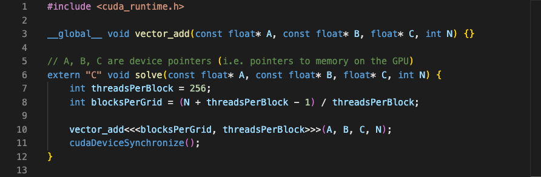

## 题目定义

编写一个 GPU 程序，对两个包含 32 位浮点数的向量执行逐元素加法程序接收两个长度相同的输入向量，并生成一个包含它们之和的输出向量

### 实现要求

- 不允许使用外部库
- `solve` 函数签名必须保持不变
- 最终结果必须存储在向量 `C` 中

### 示例 1

```text
输入：A = [1.0, 2.0, 3.0, 4.0]
      B = [5.0, 6.0, 7.0, 8.0]
输出：C = [6.0, 8.0, 10.0, 12.0]
```

### 示例 2

```text
输入：A = [1.5, 1.5, 1.5]
      B = [2.3, 2.3, 2.3]
输出：C = [3.8, 3.8, 3.8]
```

### 约束

- 输入向量 `A` 和 `B` 的长度相同
- `1 ≤ N ≤ 100,000,000`
- 性能测试使用 `N = 25,000,000`

## 模板代码解析



模板已经提供了完整的调用框架，只需补全 `vector_add` 的函数体

- `vector_add` 由 `__global__` 修饰，是在 GPU 上执行的 kernel
- `A` 和 `B` 是输入向量，`C` 是输出向量，对应公式 `C = A + B`；`N` 表示向量长度
- `A`、`B`、`C` 都指向 GPU 显存，其中 `A` 和 `B` 带有 `const`，表示只读
- `extern "C"` 让 `solve` 使用 C 语言的链接方式，避免 C++ 改写函数名，便于评测平台找到并调用它；这里的 `"C"` 与输出向量 `C` 无关
- `threadsPerBlock = 256` 表示每个 Block 启动 256 个线程
- `blocksPerGrid = (N + threadsPerBlock - 1) / threadsPerBlock` 通过向上取整计算 Block 数，确保线程总数能够覆盖全部元素
- `vector_add<<<blocksPerGrid, threadsPerBlock>>>(A, B, C, N)` 启动 kernel，`cudaDeviceSynchronize()` 等待 GPU 执行完成

## 实现思路

向量加法中，每个输出元素都可以独立计算：`C[i] = A[i] + B[i]`因此，可以让一个 GPU 线程负责一个元素每个线程只需要确定自己负责的下标、检查下标是否有效，再执行一次加法

### 1. 计算全局下标

CUDA 将线程组织成 Grid、Block 和 Thread当前线程在整个 Grid 中对应的全局下标为：

```cpp
int i = blockIdx.x * blockDim.x + threadIdx.x;
```

- `blockIdx.x`：当前 Block 在 Grid 中的编号
- `blockDim.x`：每个 Block 包含的线程数
- `threadIdx.x`：当前线程在 Block 内的编号

例如，每个 Block 有 256 个线程，那么 Block 0 负责下标 `0～255`，Block 1 负责 `256～511`，依次类推

### 2. 检查边界

Block 数通过向上取整计算：

```cpp
int blocksPerGrid = (N + threadsPerBlock - 1) / threadsPerBlock;
```

这样可以保证线程总数覆盖全部 `N` 个元素，但最后一个 Block 中可能有部分线程没有对应的数据例如，`N = 1000`、每个 Block 有 256 个线程时，会启动 1024 个线程

因此，每个线程访问数组之前都要检查：

```cpp
if (i < N)
```

缺少这个判断时，多余线程会访问数组范围之外的显存

### 3. 执行逐元素加法

通过边界检查后，线程读取 `A[i]` 和 `B[i]`，将结果写入 `C[i]`：

```cpp
C[i] = A[i] + B[i];
```

不同线程处理不同的下标，线程之间没有数据依赖，也不需要同步

### 4. 完整映射

```text
线程 0  → C[0] = A[0] + B[0]
线程 1  → C[1] = A[1] + B[1]
线程 2  → C[2] = A[2] + B[2]
...
线程 i  → C[i] = A[i] + B[i]
```

这道题的核心，是把原本由 CPU 循环完成的逐元素计算映射到 GPU 线程：

```cpp
for (int i = 0; i < N; ++i) {
    C[i] = A[i] + B[i];
}
```

转换为：

```cpp
int i = blockIdx.x * blockDim.x + threadIdx.x;

if (i < N) {
    C[i] = A[i] + B[i];
}
```

## 参考实现

```cpp
#include <cuda_runtime.h>

__global__ void vector_add(const float* A, const float* B, float* C, int N) {
    int bx = blockIdx.x;
    int tx = threadIdx.x;
    int nx = bx * blockDim.x + tx;

    if (nx < N) {
        C[nx] = A[nx] + B[nx];
    }
}

// A, B, C are device pointers (i.e. pointers to memory on the GPU)
extern "C" void solve(const float* A, const float* B, float* C, int N) {
    int threadsPerBlock = 256;
    int blocksPerGrid = (N + threadsPerBlock - 1) / threadsPerBlock;

    vector_add<<<blocksPerGrid, threadsPerBlock>>>(A, B, C, N);
    cudaDeviceSynchronize();
}
```
